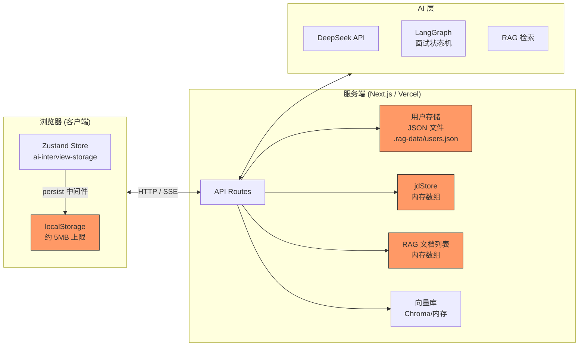
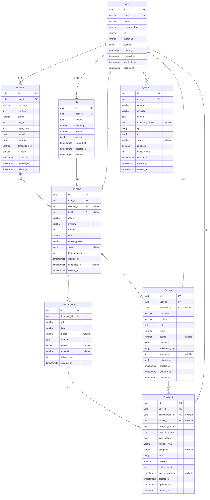
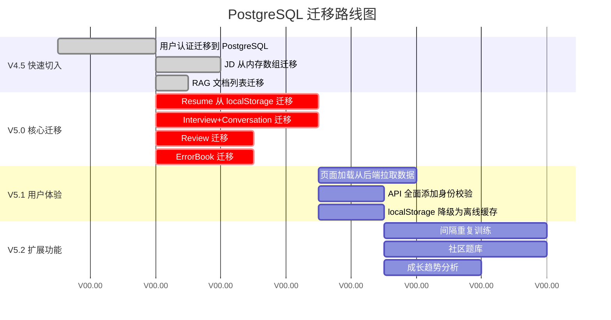

# 数据持久化分析与 PostgreSQL 数据库架构设计

> **视角：** Google Staff Engineer  
> **日期：** 2026-07-14
> **背景：** 对 AI 智能面试训练平台进行数据持久化架构审计，设计 PostgreSQL 数据库方案

---

## 目录

1. [项目当前架构分析](#一项目当前架构分析)
2. [数据持久化的 7 个核心问题](#二数据持久化的-7-个核心问题)
3. [PostgreSQL 数据库架构 ER 图](#三postgresql-数据库架构-er-图)
4. [7 个实体详解](#四7-个实体详解)
5. [完整性约束与索引策略](#五完整性约束与索引策略)
6. [迁移路线图](#六迁移路线图)
7. [附录：关键代码索引](#七附录关键代码索引)

---

## 一、项目当前架构分析

### 1.1 数据流向图



### 1.2 当前存储层一览

| 存储方式 | 数据内容 | 持久性 | 容量限制 | 并发安全 |
|---------|---------|--------|---------|---------|
| localStorage | 简历 / JD / 面试会话 / 复盘 / 错题本 | ❌ 清缓存即丢失 | ~5MB | — |
| 内存数组 `jdStore` | JD 列表 | ❌ 冷启动丢失 | — | — |
| 内存数组 `documents` | RAG 文档索引记录 | ❌ 冷启动丢失 | — | — |
| JSON 文件 `users.json` | 用户账户（含密码哈希） | ✅ 文件持久 | 文件大小 | ❌ 并发覆盖 |
| 向量库 (Chroma/内存) | 文档 Embedding | ❌ 冷启动丢失 | — | — |

### 1.3 当前数据访问模式

```
analyze-resume:   PDF上传 → AI解析 → 返回前端 → 前端存 localStorage
                  ↓ 服务端不保存解析结果，下次重新付费调用 AI

chat:            消息发送 → AI回复 → SSE返回 → 前端自行追加到 Store
                  ↓ 服务端不保存对话历史，刷新页面无可追溯

generate-report: 对话全量发到服务端 → AI评分 → 返回前端 → 前端自己存
                  ↓ 服务端处理完即丢弃

analyze-jd:      JD文本 → AI分析 → 同时存内存数组和返回前端
                  ↓ 内存数组冷启动丢失，刷新页面 JD 列表消失
```

---

## 二、数据持久化的 7 个核心问题

### 🚨 问题 1：全部业务数据在浏览器 localStorage

**代码证据：** `src/store/interview-store.ts:383-401`

```typescript
partialize: (state) => ({
  resumes: state.resumes,     // 简历（含完整工作经历）
  currentResumeId: state.currentResumeId,
  jds: state.jds,
  sessions: state.sessions,   // 面试（含完整对话历史）
  reviews: state.reviews,     // 复盘分析
  errorBook: state.errorBook, // 错题本
})
```

| 维度 | 问题 |
|------|------|
| 🔒 **隐私泄露** | 面试对话包含真实工作经历、公司信息、技术短板，全部明文在浏览器端 |
| 📍 **数据孤岛** | 换电脑 / 清缓存 / 隐私模式 → 数据全部消失，无法恢复 |
| 📱 **多端同步** | 手机、平板、多台电脑之间无法共享数据 |
| 💾 **容量上限** | localStorage 通常 5-10MB，一次深度面试很快触及限制 |

---

### 🚨 问题 2：API 路由使用内存数组存储

**代码证据：** `src/app/api/interview/analyze-jd/route.ts:27` 和 `src/app/api/rag/upload/route.ts:22`

```typescript
// analyze-jd/route.ts
// 内存中的 JD 列表（V1 方案，V4 接数据库）
let jdStore: JD[] = [];

// rag/upload/route.ts
// 内存中的文档列表（生产环境应使用数据库）
let documents: RagDocument[] = [];
```

每次 Vercel 冷启动 / 函数实例回收 → 数据全部丢失。用户在页面上能看到已分析的 JD，刷新后消失。

---

### 🚨 问题 3：用户 JSON 文件存在并发写冲突

**代码证据：** `src/lib/auth/store.ts:39-46`

```typescript
async function saveUsers(): Promise<void> {
  await fs.mkdir(DATA_DIR, { recursive: true });
  await fs.writeFile(DATA_FILE, JSON.stringify(users, null, 2));
  // 读整个文件 → 改内存 → 写整个文件
  // 多实例并发时，后写的会覆盖先写的
}
```

- Vercel serverless 下多个并发请求可能在不同实例运行，各有独立 `/tmp`
- `/tmp` 的持久性仅为"尽力而为"，不保证跨请求存在
- 并发写入时后写覆盖先写 → 注册用户却查询不到

---

### 🚨 问题 4：无用户数据隔离

所有数据缺乏 `userId` 字段，API 路由未校验用户身份。即使未来加数据库也无法区分数据所有者。

---

### 🚨 问题 5：面试消息历史无分页 / 延迟加载

**代码证据：** `src/types/interview.ts:122-134`

```typescript
export interface InterviewSession {
  messages: InterviewMessage[];  // 全量内嵌数组
}
```

一次 1 小时面试可能产生数百条消息，全量序列化到 localStorage，加载时全部读入内存。

---

### 🚨 问题 6：API 调用模式浪费 AI 计算结果

```
analyze-resume:  表单 → AI 分析 (花钱) → 返回 → 前端存 localStorage
                 服务端不保存解析结果 → 下次还得找 AI 再分析一次

analyze-review:  复盘文本 → AI 分析 (花钱) → 返回 → 前端自己存
                 错题分析结果不存服务端 → 无法跟踪学习进度
```

---

### 🚨 问题 7：数据模型缺少关键关系

| 应有关系 | 现状 | 影响 |
|---------|------|------|
| Resume ↔ InterviewSession | 仅有 `resumeId` 字符串 | 可能引用不存在的简历 |
| InterviewReview ↔ InterviewSession | 无关联字段 | 无法从面试直接跳转复盘 |
| ErrorBookEntry ↔ Question / Conversation | 无关联字段 | 无法追溯错题来源 |
| DashboardStats | 完全从内存遍历计算 | 大数据量下性能急剧下降 |

---

## 三、PostgreSQL 数据库架构 ER 图



### 核心关系一览

```
User 1──N Resume              一个人可以有多个简历版本（迭代更新）
User 1──N JD                  一个人可以分析多个岗位描述
User 1──N Interview           一个人可以参加多次模拟面试
User 1──N Question            一个人可以保存多个面试题
User 1──N Review              一个人可以有多次复盘记录
User 1──N ErrorBook           一个人有多个错题记录

Resume 1──N Interview         一份简历可以用于多次面试（更新后重练）
JD     1──N Interview         一个 JD 可以关联多次面试
Interview 1──N Conversation   一次面试有多轮对话消息
Interview 1──0..1 Review      一次面试可以产生一份复盘报告（可选）
Conversation 0..N──ErrorBook  一条对话消息可能产生多条错题（可选）
```

---

## 四、7 个实体详解

### 4.1 User — 用户

**为什么需要：** 身份认证的根基，所有数据的所有者。现有 `src/types/auth.ts` 已定义 `User` 和 `UserWithPassword`。

**核心字段：**

| 字段 | 类型 | 说明 |
|------|------|------|
| id | UUID PK | 主键 |
| email | VARCHAR(255) UNIQUE NOT NULL | 登录邮箱 |
| name | VARCHAR(100) NOT NULL | 用户姓名 |
| password_hash | VARCHAR(255) NOT NULL | 密码哈希 |
| salt | VARCHAR(64) NOT NULL | 密码盐值 |
| avatar_url | VARCHAR(500) | 头像链接（扩展） |
| settings | JSONB | 用户偏好（主题、语言等，扩展） |
| created_at | TIMESTAMPTZ NOT NULL | 注册时间 |
| updated_at | TIMESTAMPTZ NOT NULL | 最后更新 |
| last_login_at | TIMESTAMPTZ | 最后登录时间（扩展） |
| deleted_at | TIMESTAMPTZ | 软删除 |

**以后扩展：**
- OAuth 第三方登录（GitHub / Google）
- 订阅计划 / 使用量配额
- 团队版多租户（加 `organization_id`）
- 邮件验证状态

---

### 4.2 Resume — 简历

**为什么需要：** 简历是面试核心上下文。当前解析后返回前端就消失了，下次使用还得重新上传付费解析。

**核心字段：**

| 字段 | 类型 | 说明 |
|------|------|------|
| id | UUID PK | 主键 |
| user_id | UUID FK → User | 所有者 |
| file_name | VARCHAR(255) NOT NULL | 原始文件名 |
| file_size | INTEGER NOT NULL | 文件大小 |
| status | VARCHAR(32) | uploading → parsing → analyzing → ready / error |
| raw_text | TEXT | PDF 全文（用于搜索/RAG） |
| page_count | INTEGER | PDF 页数 |
| parsed | JSONB | `ResumeParsed` 结构化信息 |
| analysis | JSONB | `ResumeAnalysis` AI 分析 |
| embedding_id | VARCHAR(255) | 向量库索引 ID |
| is_active | BOOLEAN | 当前激活的简历 |
| created_at / updated_at / deleted_at | TIMESTAMPTZ | 时间戳 |

**以后扩展：**
- 版本控制：允许多版本迭代，`is_active` 标记当前版本
- 简历库：按技能 / 岗位筛选
- 简历改进建议：对比不同版本面试表现

---

### 4.3 Interview — 面试会话

**为什么需要：** 面试是核心业务流程的核心实体。需要保存状态、进度、评分，支持中断恢复和回顾。

**核心字段：**

| 字段 | 类型 | 说明 |
|------|------|------|
| id | UUID PK | 主键 |
| user_id | UUID FK → User | 应试者 |
| resume_id | UUID FK → Resume? | 关联简历（可选） |
| jd_id | UUID FK → JD? | 关联 JD（可选） |
| mode | VARCHAR(16) | tech / hr / mixed |
| difficulty | VARCHAR(16) | junior / mid / senior |
| duration | INTEGER | 计划时长（分钟） |
| status | VARCHAR(16) | preparing / in-progress / completed / cancelled |
| current_phase | VARCHAR(32) | 当前面试阶段 |
| score | JSONB? | `InterviewScore`（完成后写入） |
| total_answers | INTEGER | 回答总数 |
| created_at / completed_at / deleted_at | TIMESTAMPTZ | 时间戳 |

**为什么 score 用 JSONB：** `InterviewScore` 结构复杂（5 维评分 + 每题评分数组 + 表达反馈），查询时只整体读取。

**以后扩展：**
- 面试模板：自定义阶段顺序和题目数量
- AI 面试官风格配置
- 多人模拟群面

---

### 4.4 Conversation — 面试对话

**为什么需要：** 面试对话是核心数据。从 `InterviewSession.messages` 数组中拆出为独立表，因为：

1. 单次面试数百条消息，全量加载效率低
2. 需要支持分页（只看最近 N 条）
3. 每条消息可独立关联错题本

**核心字段：**

| 字段 | 类型 | 说明 |
|------|------|------|
| id | UUID PK | 主键 |
| interview_id | UUID FK → Interview NOT NULL | 所属面试 |
| role | VARCHAR(16) | ai / user |
| type | VARCHAR(16) | question / answer / feedback / system |
| phase | VARCHAR(32)? | 消息所在阶段 |
| content | TEXT NOT NULL | 消息内容 |
| score | SMALLINT? | 单轮评分 |
| evaluation | VARCHAR(500)? | 单轮评语 |
| token_count | INTEGER | Token 消耗 |
| created_at | TIMESTAMPTZ | 消息时间 |

**以后扩展：**
- 全文搜索（`tsvector`）
- 消息情感分析
- 回答模式分析
- 导出为 Notion / 语雀

---

### 4.5 Question — 面试题

**为什么需要：** AI 生成的面试题是有价值的练习资源。当前每次面试重新生成，无法复用历史好题。

**核心字段：**

| 字段 | 类型 | 说明 |
|------|------|------|
| id | UUID PK | 主键 |
| user_id | UUID FK → User | 所有者 |
| category | VARCHAR(32) | vue / react / javascript / css 等 |
| difficulty | VARCHAR(16) | junior / mid / senior |
| content | TEXT NOT NULL | 题目内容 |
| expected_answer | TEXT? | 参考答案 |
| tips | TEXT[] | 答题技巧 |
| tags | TEXT[] | 自定义标签 |
| source | VARCHAR(100)? | 题源标记 |
| is_public | BOOLEAN | 是否公开（扩展） |
| usage_count | INTEGER | 练习次数 |
| created_at / updated_at / deleted_at | TIMESTAMPTZ | 时间戳 |

**以后扩展：**
- 题目社区：用户可公开好题
- 题目组：关联到特定公司/岗位题库
- 刷题模式：每日随机 N 题
- 题目版本管理

---

### 4.6 Review — 面试复盘

**为什么需要：** 面试复盘是学习闭环的关键。用户粘贴真实面试经历 → AI 分析 → 生成错题和改进建议。持久化后支持成长对比。

**核心字段：**

| 字段 | 类型 | 说明 |
|------|------|------|
| id | UUID PK | 主键 |
| user_id | UUID FK → User | 所有者 |
| interview_id | UUID FK → Interview? | 关联平台内面试 |
| company | VARCHAR(100) | 面试公司 |
| position | VARCHAR(100) | 岗位 |
| date | DATE | 面试日期 |
| result | VARCHAR(10) | pass / fail / pending |
| source | VARCHAR(32)? | 来源标记 |
| questions | JSONB | `ReviewQuestion[]` 数组 |
| weakness_tags | TEXT[] | 弱点标签 |
| summary | TEXT? | AI 总结 |
| action_items | TEXT[]? | 改进计划 |
| created_at / updated_at / deleted_at | TIMESTAMPTZ | 时间戳 |

**以后扩展：**
- 成长曲线：多次 Review 聚合展示弱项改善
- 面试时间线
- 对标分析：对比同岗位用户平均水平

---

### 4.7 ErrorBook — 错题本

**为什么需要：** 错题本是学习核心驱动。记录错误类型、掌握程度、复习历史，支持间隔重复训练。

**核心字段：**

| 字段 | 类型 | 说明 |
|------|------|------|
| id | UUID PK | 主键 |
| user_id | UUID FK → User | 所有者 |
| conversation_id | UUID FK → Conversation? | 来源对话 |
| review_id | UUID FK → Review? | 来源复盘 |
| question_content | TEXT NOT NULL | 错题内容 |
| correct_answer | TEXT NOT NULL | 正确答案 |
| your_answer | TEXT NOT NULL | 你的答案 |
| mistake_type | VARCHAR(32) | concept-error / expression / depth / structure |
| company | VARCHAR(100)? | 来源公司 |
| tags | TEXT[] | 标签 |
| mastery | SMALLINT | 掌握度 0-5 |
| review_count | INTEGER | 复习次数 |
| last_reviewed_at | TIMESTAMPTZ? | 上次复习时间 |
| created_at / updated_at / deleted_at | TIMESTAMPTZ | 时间戳 |

**以后扩展：**
- 间隔重复算法（Spaced Repetition，类 Anki）
- 错题推荐：基于薄弱知识点自动推送练习题
- 错题统计仪表盘
- Anki 卡片导出

---

## 五、完整性约束与索引策略

### 5.1 通用约束

```sql
-- 所有表软删除
deleted_at TIMESTAMPTZ DEFAULT NULL

-- 外键 NOT NULL（除非标记 nullable）
ALL FK → User(id) → NOT NULL
```

### 5.2 核心索引

```sql
-- User
CREATE UNIQUE INDEX idx_user_email ON User(email) WHERE deleted_at IS NULL;

-- Resume
CREATE INDEX idx_resume_user ON Resume(user_id) WHERE deleted_at IS NULL;
CREATE INDEX idx_resume_active ON Resume(user_id, is_active) WHERE deleted_at IS NULL;

-- JD
CREATE INDEX idx_jd_user ON JD(user_id) WHERE deleted_at IS NULL;

-- Interview
CREATE INDEX idx_interview_user ON Interview(user_id) WHERE deleted_at IS NULL;
CREATE INDEX idx_interview_status ON Interview(status) WHERE deleted_at IS NULL;

-- Conversation
CREATE INDEX idx_conv_interview ON Conversation(interview_id, created_at);

-- Question
CREATE INDEX idx_question_user ON Question(user_id) WHERE deleted_at IS NULL;
CREATE INDEX idx_question_category ON Question(user_id, category) WHERE deleted_at IS NULL;

-- Review
CREATE INDEX idx_review_user ON Review(user_id) WHERE deleted_at IS NULL;
CREATE INDEX idx_review_date ON Review(user_id, date DESC) WHERE deleted_at IS NULL;

-- ErrorBook
CREATE INDEX idx_errorbook_user ON ErrorBook(user_id) WHERE deleted_at IS NULL;
CREATE INDEX idx_errorbook_mastery ON ErrorBook(user_id, mastery) WHERE deleted_at IS NULL;
CREATE INDEX idx_errorbook_type ON ErrorBook(user_id, mistake_type) WHERE deleted_at IS NULL;
```

### 5.3 JSONB 字段设计原则

| 字段 | 所属表 | 使用 JSONB 理由 |
|------|--------|----------------|
| `parsed` | Resume | AI 解析结果，结构迭代频繁 |
| `analysis` | Resume / JD | AI 分析结果，格式不可预测 |
| `score` | Interview | 复杂嵌套（维度 + 每题评分 + 表达反馈） |
| `questions` | Review | 不定长数组，每个含 PREP 嵌套 |

---

## 六、迁移路线图

### 四阶段计划



### 各阶段详解

**第一阶段：V4.5（当前可立即动手）**

| 优先级 | 任务 | 影响 |
|-------|------|------|
| P0 | User → PostgreSQL | 修复登录注册不稳定 |
| P1 | JD → PostgreSQL | 消除最明显的数据丢失 Bug |
| P2 | RAG 文档列表 → PostgreSQL | 消除内存数组依赖 |

**第二阶段：V5.0（核心业务迁移）**

按外键依赖顺序执行：`User → Resume → Interview → Conversation → Review → ErrorBook`

**第三阶段：V5.1（架构调优）**
- 页面初始化从后端 API 拉取数据
- 所有 API 路由通过 JWT 校验用户身份
- localStorage 降级为客户端离线缓存

**第四阶段：V5.2（新功能）**
- 间隔重复算法
- 社区题库
- 成长趋势分析

---

## 七、附录：关键代码索引

| 文件 | 行号 | 内容 |
|------|------|------|
| `src/types/interview.ts` | 1-298 | 全部类型定义 |
| `src/store/interview-store.ts` | 1-403 | Zustand store + persist |
| `src/services/storage.ts` | 1-104 | localStorage 辅助工具 |
| `src/lib/auth/store.ts` | 1-106 | JSON 文件用户存储（并发问题） |
| `src/app/api/interview/analyze-jd/route.ts` | 27 | 内存数组 `jdStore` |
| `src/app/api/rag/upload/route.ts` | 22 | 内存数组 `documents` |
| `src/app/api/interview/chat/route.ts` | 30-60 | SSE 面试对话（不持久化） |
| `src/app/api/interview/analyze-resume/route.ts` | 27-103 | 简历上传（不存服务端） |
| `src/app/api/auth/login/route.ts` | 1-72 | 登录（JSON 文件） |
| `src/app/api/auth/register/route.ts` | 1-90 | 注册（JSON 文件） |

---

## 核心结论

当前项目最大的架构问题是**数据两面性**：

```
┌─ localStorage ─────────────────────────────────┐
│  简历 / 面试会话 / 复盘 / 错题本                │
│  → 清缓存丢失 / 无法多端同步 / 容量 5-10MB      │
└────────────────────────────────────────────────┘

┌─ JSON 文件 (.rag-data/users.json) ─────────────┐
│  用户认证数据                                    │
│  → 并发写覆盖 / Vercel /tmp 不可靠              │
└────────────────────────────────────────────────┘

┌─ 内存数组 ──────────────────────────────────────┐
│  JD 列表 / RAG 文档列表                          │
│  → 冷启动全部丢失                                │
└────────────────────────────────────────────────┘
```

**目标架构：** PostgreSQL 作为权威数据源，localStorage 降级为离线缓存，API 作为统一数据出入口。
